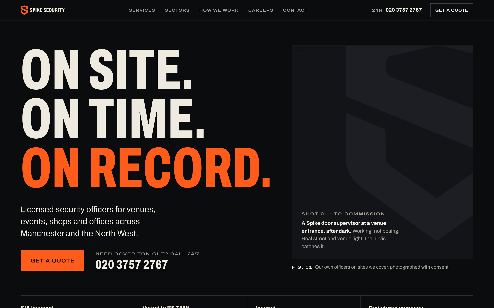
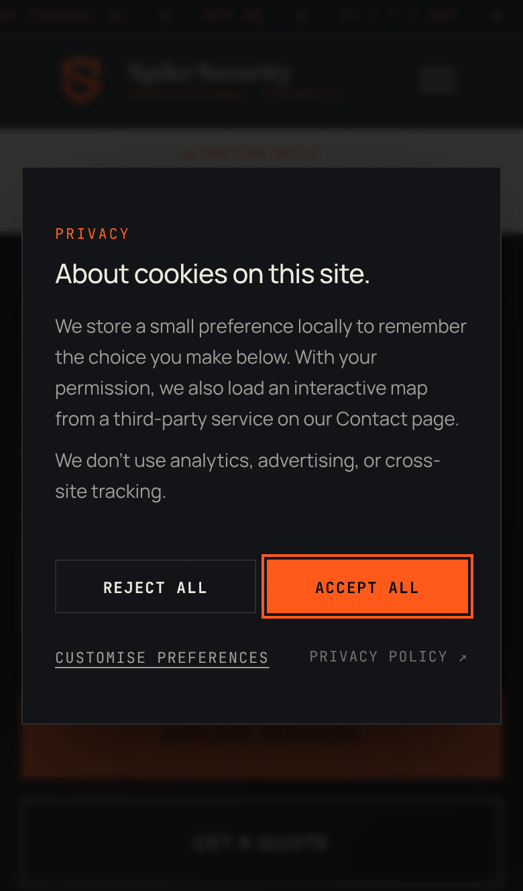
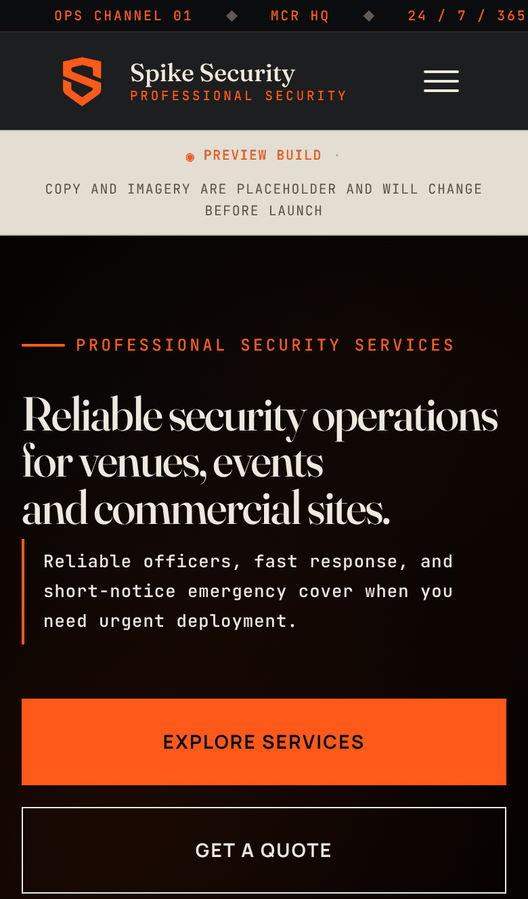
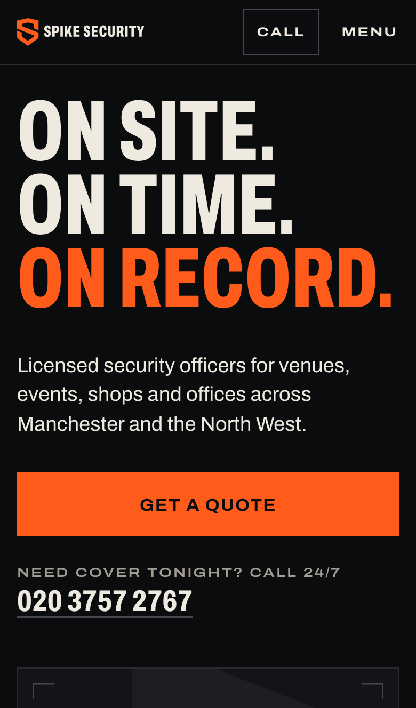
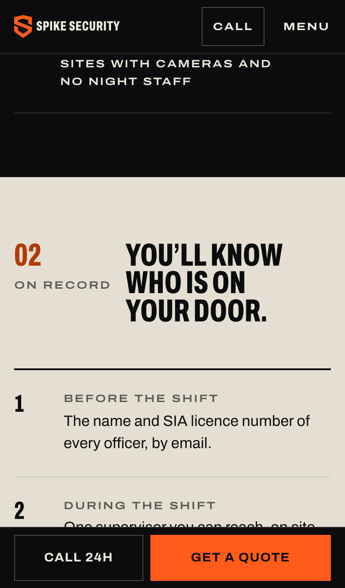

# Spike Security: site improvement plan

**Status:** in progress. Phases 0 to 3 are live on www.spikesecurity.co.uk as of 23 November 2026; see [Progress](#progress) for what changed from this plan along the way.
**Covers:** moving the whole site to brand v3.0, removing the AI tells, the tone of the copy, and making the site look like a designer with a budget built it.
**Companion files:** [`DESIGN.md`](../DESIGN.md) (the brand system), [`PRODUCT.md`](../PRODUCT.md) (users, purpose, principles), the homepage frame in [`site-plan/`](site-plan/) (open [`homepage-frame.html`](site-plan/homepage-frame.html) in a browser, or see the images below).

Where a skill asked a question, it has been answered on your behalf. Every one of those answers is listed in [section 10](#10-decisions-made-on-your-behalf) so you can overrule any of them.

---

## Progress

**Done and live**

- **Phase 0.** The contact form no longer fakes a send; the hidden testimonials and the unevidenced claims are gone; the theme colour is obsidian.
- **Phases 1 to 3** (apart from the claims register). The whole site is rebuilt on brand v3.0 with Eleventy (`src/`), deployed from `_site/` only: home, services and six service pages, how we work, about, careers with an application form, contact with a quote form, legal, privacy, site map and a 404. One font file (88 KB, self-hosted), no icon font, no third-party requests until a visitor turns a map on. Every page loads in 4 requests and about 170 KB, against 4.3 MB before.
- **Checks.** No AI-tell patterns from the Impeccable detector on any page; no contrast failures; every page reflows at 200% text on a phone; tap targets 44 px (links inside sentences excepted); 29 behaviour checks pass (menu, dock, both forms, FAQs, 404).

**Changed from the plan**

- **Numbering.** Numbers now appear only where order matters (booking steps, how to apply). Section headings have no numerals on the website, and services, promises, figures and facts are not numbered. DESIGN.md has the rule.
- **The shift report** uses the one-colour obsidian shield, so the paper stays greyscale.
- **Careers** has no shield graphic behind it; the section is copy and a list of roles.
- **The area map** is a real map (Leaflet, as on Horizon), not the schematic, full width once maps are allowed, with no duplicate "Who we work for" list beside it (it repeated the six service links). CARTO's dark tiles, which the old contact page used, now return "API key required" on every tile, so the maps use OpenStreetMap's tiles, darkened to the brand's greys, with town names on obsidian sign plates.
- **The phone footer** hides the page links, which the menu already has.
- **Hosting stays on GitHub Pages.** The Cloudflare account connected to this project has no domains in it, so there was nothing to move to safely. The build now deploys only `_site/`.
- **Forms** open the visitor's email app with everything filled in, and say so plainly, until a form service is connected. Set `formEndpoint` in `src/_data/site.json` and the same forms post to it, with sending, sent and failed states already built.
- **No placeholder photo frames on the live site.** Until the shoot, the home cover carries the shield in Signal mode.
- **Labels, buttons and menus** are sentence case at Archivo's normal width. The wide, spaced-out capitals ("MENU", "OFFICES, RECEPTIONS, HQS") read as a template and were hard to read small. The brand page and DESIGN.md follow the same rule; signs keep their condensed capitals.
- **Cookie prompt.** Maps load only after the visitor allows them in a small cookie prompt (a bottom sheet on phones) with two equal buttons. "Show the street map" opens it, and "Cookie settings" in the footer reopens it. It never blocks the page.
- **Footer** cut to three calm rows on desktop: logo and page links; number, email and office; legal line.
- **Vehicles** are no longer part of the brand: the van drawing and the livery rules are gone from the brand page and DESIGN.md.
- **Brand pack refreshed.** Site signs and social images use the calmer sentence-case labels, the signs set the 24-hour number in Martian Mono, the pack includes both fonts with their licences, and the brand page loads its fonts from our own site, as the privacy notice says.
- **Martian Mono for the numbers** (brand 3.1). A typeface built for code, with a slashed zero, at 87.5% width. It sets the phone number everywhere it appears (bar, cover, menu, contact, footer and the full-width finale), times, dates and references in the shift report, company and licence numbers, the numbered steps, the phone and licence fields in the forms, and colour values and measurements on the brand page. It replaced Chivo Mono, which did not read as code. Words stay in Archivo (the Record Rule in DESIGN.md).
- **Coverage diagram.** The home page's area section draws where we work instead of showing an empty map box: the office, rings at 5 and 10 miles, and the six areas with their straight-line distance in Martian Mono, all worked out from coordinates in `site.json`. It needs no cookies; the street map is still one tap away and opens in the same frame. Both map buttons now say "Show the street map", and the legal and privacy pages match.
- **Link previews.** Sharing any page on WhatsApp, iMessage, LinkedIn or Slack shows a card made for it: the page's headline, what Spike does and the 24-hour number, with the shield. Twelve cards, one per main page, drawn from the pages themselves by `npm run og`.
- **Measured.** Lighthouse on a throttled phone: performance 99, accessibility, best practices and SEO 100 (home, a service page, contact); 100 in every category on desktop.
- **More answers.** Every service page now answers four or five questions (stopping a shoplifter, keyholding, what happens when an alarm goes off, monitoring hours), each built only from what the page already says, and in its structured data.
- **Print.** Any page prints as a clean black-on-white document with the logo, the answers opened and the company details at the end, for clients who print or save quotes as PDF.
- **Search and AI.** Every page now carries one connected schema.org graph (business, website, page, breadcrumbs, service, questions and answers), a plain-Markdown copy at its own `.md` address, and a place in a sitemap that finally lists all 15 pages (the home page and five service pages were missing) with real last-changed dates. `/llms.txt` gives AI assistants the facts they can rely on and `/llms-full.txt` the whole site; `robots.txt` welcomes them by name. Titles and descriptions fit what search results show, and the old `/join-us/` address can now be followed to Careers.
- **Service pages show the record.** Each one now has a paper section with a sample record for that service: an event report, a patrol log with photos, a monitoring log with footage times. Every entry describes work the page already promises, and each is marked as a sample with invented details.
- **Search:** service pages describe themselves as services, every main page has breadcrumbs for search results, the home page's title says what Spike does, and "About Spike Security" no longer repeats the name.
- **How we work** ends with insurance and "If something goes wrong" side by side, which breaks a run of five identical sections. The 404 page's links now line up with the page.

**Still to do:** the photo shoot, case studies and Google Business Profile (Phase 4), a form service, and the facts in [section 11](#11-facts-only-spike-can-confirm). The homepage frame in `docs/site-plan/` is kept as the original direction; the live site supersedes it.

---

## Contents

1. [Summary](#1-summary)
2. [What we found](#2-what-we-found)
3. [Goals and how we will measure them](#3-goals-and-how-we-will-measure-them)
4. [Design direction](#4-design-direction)
5. [Copy and tone](#5-copy-and-tone)
6. [Page by page](#6-page-by-page)
7. [Technical plan](#7-technical-plan)
8. [What the budget buys](#8-what-the-budget-buys)
9. [Roadmap](#9-roadmap)
10. [Decisions made on your behalf](#10-decisions-made-on-your-behalf)
11. [Facts only Spike can confirm](#11-facts-only-spike-can-confirm)
12. [Appendix: method and evidence](#12-appendix-method-and-evidence)

---

## 1. Summary

**The brand is strong; the site does not use it.** The live site was built before brand v3.0 and reads as a template: a small orange label above every heading, a scrolling ticker, a green "LIVE" light, an "operations" panel with made-up readouts, six identical icon cards, stock photos of an office meeting, and copy that could belong to any security firm ("Comprehensive Security Solutions", "peace of mind", "Not just security. A partnership."). Impeccable's detector finds 17 kicker labels and 3 eyebrow chips across 8 pages, plus a ticker and a pulsing light on every page.

**One thing is urgent.** The contact form on the live site does not send anything. When someone presses Send, the page waits 0.9 seconds and says "Your message has been sent. We'll be in touch shortly!", and the message goes nowhere (`js/main.js`, line 210: "Simulate successful submission"). Any enquiry typed into it has been lost. This is Phase 0 and should be fixed this week.

**The plan in five moves:**

1. **Stop the leaks (this week).** Make the form send, remove the hidden invented testimonials from the page source, and take down claims we cannot evidence.
2. **Rebuild on brand v3.0.** One typeface (Archivo), obsidian and bone with one orange signal, hanging section numerals instead of labels, rows and rules instead of cards, no icon font. This also fixes most of the accessibility and speed problems: the current pages load 4.1 MB of fonts each, and 3.9 MB of that is an icon font.
3. **Show proof instead of adjectives.** Make "On site. On time. On record." concrete: licence numbers before the shift, a named supervisor, a written report by 9am. Show a real (redacted) report on the site.
4. **Rewrite the copy in Spike's voice.** Plain British English, specifics over adjectives, one label per action, no invented claims.
5. **Spend where an AI cannot fake it.** A one-day photo shoot of real Spike officers, three case studies with client permission, and real kit (uniforms, signs) in the pictures.

**What it looks like.** The homepage frame below is built from the brand system only. The grey "shot" panels mark where the commissioned photographs go.



| Now: first visit on a phone | Now: after the cookie choice | Proposed | Proposed, after scrolling |
|---|---|---|---|
|  |  |  |  |

Full pages: [proposed desktop](site-plan/homepage-desktop.png), [proposed phone](site-plan/homepage-phone.png), [current desktop](site-plan/current-desktop.png).

---

## 2. What we found

### 2.1 Scores

| Measure | Current site | Target at launch |
|---|---|---|
| Nielsen heuristics (Impeccable critique) | **20 / 40** (Acceptable, bottom of the band) | 34 or more |
| Cognitive load checklist (homepage) | 3 failures (moderate) | 0 or 1 |
| Impeccable detector, AI tells | 17 kickers, 3 eyebrow chips, 8 marquees, 8 pulsing dots, 9 grid backgrounds, 8 overused-font flags | 0 |
| Detector, quality findings | 72 undersized text, 12 low contrast, 3 skipped headings | 0 real findings |
| Homepage frame, AI tells | 0 | |
| Fonts downloaded per page | **4,131 KB** (Material Symbols 3,931 KB) | 100 KB or less |
| Third-party hosts before consent | Google Fonts (2 hosts), Unsplash | none |
| Content hidden until JavaScript runs | 16 blocks on the homepage | none |
| Pages that scroll sideways at 200% text on a phone | 5 of 8 (up to 645 px wide on a 390 px screen) | 0 |
| Tap targets under 44 px on a phone | 9 to 17 per page | only links inside sentences |
| Contrast failures | orange on bone 2.3 to 2.6:1; dark orange on obsidian 4.0:1; grey body text on the About page 2.5:1 | none |
| Contact form | **does not send** | sends, with a reference number and a fallback |

Nielsen scores, with the main reason for each:

| # | Heuristic | Score | Key issue |
|---|---|---|---|
| 1 | Visibility of system status | 1 | The form reports success without sending. "LIVE" and "Unit status: Deployed" report a status that does not exist. |
| 2 | Match with the real world | 2 | "OPS CHANNEL 01", "CH 01" and terminal-style text are costume. BS 7858 is never explained. |
| 3 | User control and freedom | 3 | A cookie dialog blocks the first view, but it has a clear Reject button. Navigation is simple. |
| 4 | Consistency and standards | 2 | The phone number appears in three formats; 16 different button labels for about five actions; Title Case and capitals mixed. |
| 5 | Error prevention | 2 | Required fields and a service picker exist; no help with dates, hours or numbers of officers. |
| 6 | Recognition rather than recall | 2 | On the homepage the phone number appears once, in the footer, 7,300 px down on a phone. All six "Learn more" links go to the same page. |
| 7 | Flexibility and efficiency | 2 | No quick path for "I need cover tonight"; applying means writing an email with a CV attached. |
| 8 | Aesthetic and minimalist design | 1 | Ticker, live light, preview banner, operations panel, stats bar, icon cards, pills and rules all compete. |
| 9 | Error recovery | 2 | Inline validation is clear; a failed send is invisible because nothing is sent. |
| 10 | Help and documentation | 3 | A useful FAQ on Contact and a clear "How to apply". |
| | **Total** | **20 / 40** | **Acceptable** |

### 2.2 What is working

- **The palette is already close.** The v2 stylesheet uses the same obsidian, bone and Spike Orange as brand v3.0, so the rebuild changes type, components and copy, not every colour.
- **Privacy is taken seriously.** The map only loads after consent, the site has no ads or analytics, and the privacy notice is thorough.
- **The form has good bones.** Labels, `autocomplete`, inline errors and a skip link are already there. It needs a real destination, not a redesign.

### 2.3 The AI smell, item by item

Each of these is a pattern that generated sites repeat. Together they make the site look assembled rather than designed.

| Tell | Where | Why it reads as AI | Replace with |
|---|---|---|---|
| Small orange label above every heading ("WHAT WE DO", "OUR STORY", "WE’RE HERE TO HELP") | 20 headings, every page | The most common template opening; Impeccable bans it outright | The hanging section numeral from DESIGN.md: number and section name beside the headline, never above it |
| One word of each headline in orange serif italic ("Our Security *Services*", "Get in *Touch*") | Every page hero | A stock "accent word" trick; DESIGN.md bans serif italics in headlines | One statement in condensed capitals; orange reserved for the last line of the cover only |
| Orange rule under each heading | Every section | Decoration that repeats the heading's job | Nothing; hairlines separate sections, not headings |
| Scrolling ticker ("OPS CHANNEL 01 · MCR HQ · 24/7/365") | Top of every page | Dashboard theatre; also fails WCAG 2.2.2 (moving content with no pause for touch or keyboard users) | Nothing. The 24-hour number sits in the bar instead |
| "LIVE" pill with a pulsing green light; "Operations / Live" panel with "Unit status: Deployed" | Header, homepage hero | Invented live data, named in PRODUCT.md as an anti-reference | A strip of four facts anyone can check |
| Monospace capitals for body text | 62 elements on the homepage | "Technical" costume on a brand that is not a tech company | Archivo; capitals only for signs and labels |
| Six identical cards: icon in a box, big italic number, title, text, "Learn more" | Home, Services | Identical card grid, banned by Impeccable | Service rows on a 12-column grid, each linking to its own page |
| Icon font (Material Symbols) | 29 icons across 5 pages | Generic icons, and 3.9 MB per page | No icons, or a small custom set drawn from the shield (section 8) |
| Stats bar with icons and tiny capitals | Homepage | Hero-metric template | Folded into the facts strip |
| Eight "industry" pills with icons | Homepage | Chip soup | A plain list of sectors, each linking to real content |
| "Why choose us" tick list | Homepage | Generic and unprovable | The "On record" promises and a sample report |
| Five-star testimonials (hidden, still in the source) | Homepage | Invented: "three years" of service from a company founded in 2025 | Removed. Later: real case studies and linked genuine reviews |
| Stock photos: sticky notes on a whiteboard, glass towers, hands with a pen | About, Home, page heroes | Nothing to do with security in Manchester | Commissioned photographs of Spike officers at work |
| Centred banner: "Ready to Secure Your Business?" | Every page | The default ending of a template | An orange finale with the 24-hour number set like a road sign |
| Mission, Vision and Values cards | About | Corporate boilerplate | Named people, the office, company facts |
| "Getting started is simple" 1-2-3 | Services, Careers | Template process strip | Timed steps with real numbers on each service page |
| Grain overlay, fade-in on scroll | Every page | Decorative motion; hides content until JavaScript runs | One cover entrance; nothing else moves |
| Fraunces display serif | Every page | On Impeccable's reflex-reject list | Archivo, condensed capitals |

### 2.4 Broken or risky

**P0: blocking**

- **The contact form fakes success.** See the summary. Live on www.spikesecurity.co.uk today.

**P1: fix before launch**

- **Claims we cannot evidence.** Under the CAP Code (rule 3.7) a business must hold evidence for objective claims before publishing them. Each of these needs evidence or removal:
  - "NSI-accredited control room" (Services). NSI certification is checkable; if Spike does not hold it, this must go.
  - "Enhanced DBS checked" (Services, AI context files). Enhanced checks are only lawful for roles the law makes eligible, mainly work with children or vulnerable adults. Most security roles get a basic check, and the SIA licence includes its own criminal record check. Say exactly which checks Spike runs.
  - "24/7 control room", "hundreds of businesses", "one of Greater Manchester's most respected", "Nationally trusted", "above-industry-average rates", "paid weekly".
  - An orange "SIA" badge over the heading "Security Services Scheme". Readers may take this for the SIA Approved Contractor Scheme, which only approved firms may claim. Replace with a plain statement: every officer holds an SIA licence, and here is how to check it.
- **Invented testimonials in the source.** They are hidden but still in `index.html`, readable by anyone who views the source and by search and AI crawlers. Fake reviews have been a banned practice under the Digital Markets, Competition and Consumers Act 2024 since 6 April 2025. Delete them.
- **Accessibility:** orange text on bone (2.3 to 2.6:1), dark orange tags on obsidian (4.0:1), grey body text on the About page (2.5:1); the ticker moves with no pause for touch or keyboard users; 5 pages scroll sideways at 200% text; heading levels skip on Contact and Services; tap targets below the 44 px set in PRODUCT.md.
- **Speed and privacy:** 4.1 MB of fonts on every page; requests to Google and Unsplash on first load, which share each visitor's IP address with those companies; 16 homepage sections stay invisible until JavaScript runs.

**P2: fix in the rebuild**

- The phone number is written three ways (020 3757 2767, 020 37 57 27 67, and two `tel:` forms). It is a London number for a Manchester company; see [section 11](#11-facts-only-spike-can-confirm).
- 16 different button labels for about five actions ("Get a Quote", "GET A QUOTE", "Request a Quote", "Contact Us", "Get in Touch", "Explore Services" and more).
- Three different promises about reply times: 2 to 4 hours, within 24 hours, within 12 hours out of hours.
- Structured data uses a type that does not exist (`SecurityService`) and lists 5 of the 6 services.
- `theme-color` is navy (`#0D1B2E`), the retired v1 colour. The social share image is an SVG, which most platforms will not show. The favicon file name contains spaces.
- No 404 page: a mistyped address shows GitHub's default page.
- A full-screen cookie dialog blocks the first view on every new visit, although the site only needs consent for the map, which already has its own consent gate.
- The deploy publishes the whole repository. Today that makes `docs/style-guide.md` and the AI context files public URLs; `PRODUCT.md`, `DESIGN.md`, `scripts/` and this plan will join them when this branch is merged.
- 87 em dashes in the source of the eight pages (the detector counts 19 in Privacy's body text alone); "an security licence" on Careers.

### 2.5 Walking through it as the people who use it

**A venue manager, Friday at 6pm, two door staff short for tonight (buyer, from PRODUCT.md).** On a phone, the first screen is a cookie dialog. After that: a ticker, a preview banner, a label and a serif headline about "security operations". The orange button says "Explore services", not "call us". The phone number appears once, in the footer, 7,300 px down. If they use the form, they are told the message was sent, and wait for a call that never comes. The FAQ that says pre-planned work needs 48 to 72 hours' notice is on another page.

**A door supervisor applying after a night shift (applicant).** "Apply Now" opens an email app with a pre-filled message and asks for a CV attachment; many phones have no mail account set up and no CV on them. The hero says "If you hold an security licence". Pay is "above-industry-average" with no number, and shifts are described only as "weekend/evening" or "mixed day/night".

**First-time visitor (Impeccable's Jordan).** "BS 7858", "keyholding" and "static officer" are never explained. "Learn more" on six different services leads to the same page.

**Phone user on the move (Casey).** The headline starts 289 px down a 664 px screen; the ticker, header and preview banner take about 180 px of that. The first visit loads more than 4 MB. Nothing important sits in the thumb zone.

**Screen reader and low-vision user (Sam).** Orange labels on bone are unreadable for many people (2.3:1). The ticker keeps moving. At 200% text, five pages need sideways scrolling.

**Someone checking the claims (Riley).** View the source and five-star reviews appear that contradict the founding date. The Services page claims an NSI-accredited control room; nothing else on the site mentions one.

### 2.6 Where the skills disagreed, and what we kept

`ui-ux-pro-max` recommended a "Trust & Authority" style: navy primary, a blue call to action, Poppins and Open Sans, testimonial carousels, certificate carousels and "metric pulse" animations. **We rejected the look.** It is the category reflex Impeccable warns about (security, therefore navy), it would replace the brand you have just approved, and it repeats the dashboard theatre PRODUCT.md rules out. **We kept its substance:** credentials visible rather than hidden, proof placed before the call to action, clear form states (loading, success, error), the right mobile keyboards (`inputmode`), `font-display: swap`, and image optimisation.

---

## 3. Goals and how we will measure them

PRODUCT.md defines success as "a buyer calling or sending an enquiry within one visit, and an applicant applying without needing to ask a question first."

| Goal | Measure | How it is counted |
|---|---|---|
| More enquiries | Quote forms sent and taps on the phone number, per month | First-party, cookie-free counts (section 7.9) |
| Faster first contact | Share of enquiries answered within the published time | Ops log |
| Applicants finish | Applications completed against application pages viewed | Form counts |
| Quick to apply | A licence holder applies on a phone in under 3 minutes | Timed test with three real applicants |
| Trust | Every published claim has evidence on file | Claims register (section 5.6) |
| Quality | Nielsen 34/40 or more; detector shows no AI tells; WCAG 2.2 AA | Re-run the skills before launch |
| Speed | Largest content shown within 2.0 s on a mid-range phone over 4G; layout shift under 0.05; 400 KB or less on first load including the hero photo | Lighthouse and the Playwright checks in `scripts/qa/` |

---

## 4. Design direction

### 4.1 The design brief (Impeccable shape, confirmed on your behalf)

1. **Summary.** The public website for Spike Security, rebuilt on brand v3.0: home, services, how we work, about, careers, contact and quote, plus legal pages. It has to prove quickly that Spike is licensed, reliable and reachable, and look unmistakably like the same company as the uniforms and signs.
2. **Primary user action.** Buyers: call the 24-hour number or send a quote request with the site, dates and hours. Applicants: apply from a phone in under three minutes.
3. **Design direction.**
   - **Colour strategy:** Restrained on obsidian, with one drenched orange section per page (the finale). About 70 obsidian, 20 bone, 10 orange, as DESIGN.md sets out.
   - **Scene sentence:** a venue manager in a car park at 6pm on a Friday, phone in one hand, two door staff short for tonight, needing to know within ten seconds whether Spike can cover it and how to call. Dark, high contrast, big type, the number within thumb reach.
   - **Anchors:** UK road signage (Kinneir and Calvert): read at a distance, nothing decorative. Hi-vis workwear and rail orange: orange as a working colour. GOV.UK: plain, specific, accountable language. Within that, the brand page's own spec-sheet rigour: numbered sections, figure captions, hairlines.
4. **Scope.** This round: the plan and one high-fidelity homepage frame (desktop and phone), static. The build follows the roadmap in section 9.
5. **Layout strategy.** Left-aligned, 12-column grid shared by every section head and the rows beneath it, so names line up with titles. One statement per section in condensed capitals with a hanging numeral. Light bone "paper" sections for documents and proof. One shield crop per page. Rows and rules instead of cards.
6. **Key states.** Quote form: empty, invalid (inline, focus moves to the first error), sending, sent (with a reference number and what happens next), failed (keeps what was typed and shows the phone number), and a no-JavaScript path. Careers: roles open, no roles open ("leave your details"). Map: off until consent. Pages: 404.
7. **Interaction model.** A slim sticky bar with the 24-hour number and a ghost "Get a quote". On phones, a dock with "Call 24h" and "Get a quote" appears once the cover's own buttons scroll away, and hides again at the orange finale, so there is only ever one orange button on screen. Rows highlight on hover; nothing else animates except the cover's entrance.
8. **Content requirements.** Real facts from section 11, the sample report, service descriptions, role details with pay, and the photographs in section 8.1.
9. **References for the build.** Impeccable `spatial-design.md`, `typography.md`, `interaction-design.md` (forms), `motion-design.md` (the single entrance), `ux-writing.md`.
10. **Open items.** Everything in section 11.

Image probes were skipped because this environment cannot generate images; the HTML frame takes their place and shows the direction in the real type and colours.

### 4.2 The homepage frame, section by section

Open [`site-plan/homepage-frame.html`](site-plan/homepage-frame.html) in a browser to see it at any width.

| Section | What it does | The brand move |
|---|---|---|
| Bar | Logo, five links, the 24-hour number, a ghost "Get a quote" | The real lockup instead of typed text; one orange underline for the current page |
| Cover | "ON SITE. ON TIME. ON RECORD." with a plain sentence about what Spike does, the primary button and the number | The brand line as the display; the sentence is part of the `h1`, so search engines and screen readers get the facts |
| Facts strip | SIA licensed (with a link to check), vetted to BS 7858 (explained), insured, registered company number | Checkable facts replace the fake operations panel |
| 01 Services | "Six services. One number to call." Six rows: name, what it is, who it is for | Rows on the page grid instead of icon cards |
| 02 On record | "You'll know who is on your door." Before, during and after the shift; a sample shift report | Bone paper section; the brand line made into a real document |
| 03 Area | "Inside the M60, and well beyond it." A schematic M60 map with the office in Cheetham Hill; sector links | A signage-style diagram drawn for Spike, not a stock map |
| 04 Careers | "Good officers get steady shifts." Open roles with location and shift pattern | The shield crop in Shadow mode behind the list |
| Finale | The 24-hour number at full width on orange, a sentence, an obsidian button | A road sign on a web page |
| Footer | Number, email, office, links, trading disclosure, the brand line | Registered name, number, place of registration and office, as the 2015 trading disclosure rules require |

### 4.3 Principles for every page

1. **Show the brand; do not describe it.** No page says "professional", "trusted" or "reliable". The type, the facts and the photographs say it.
2. **One statement per section.** A short sentence in condensed capitals, beside a hanging numeral. Never a label above a heading.
3. **Orange marks what matters.** The shield, one action per screen and the section numeral, as DESIGN.md sets out. The cover's last line is the one deliberate exception. Text on bone uses Ember, never orange.
4. **Rows, rules and paper, not cards.** Hairlines group things. Bone sections hold documents and proof.
5. **Real things only.** Our officers, our kit, our sites (with permission), named people, real numbers. Placeholders are labelled as placeholders until the shoot.
6. **Captions are part of the voice.** "Fig. 02 · Door team, Northern Quarter, 22:40". Place and time make a photograph read as a record.
7. **The 24-hour number is signage.** Always in the bar, large in the finale, in the dock on phones, and in the same format everywhere.
8. **Motion is a single entrance.** The cover rises once on load. Hover changes colour. Nothing else moves, and nothing moves under reduced motion.
9. **Fast is part of the look.** One font file, no icon font, no stock photos from other servers.

### 4.4 Component map: from v2 to v3

| v2 component | Fate | v3 component |
|---|---|---|
| Ticker | Remove | None |
| "LIVE" pill | Remove | None |
| Preview banner | Remove at launch | Staging only |
| Header: typed "Spike Security" in Fraunces with "PROFESSIONAL SECURITY" in orange monospace | Replace | Bar with the horizontal lockup SVG, 60 px tall |
| Hero: eyebrow, serif `h1` with orange italic word, monospace paragraph with an orange side stripe | Replace | Cover: display statement, lede inside the `h1`, primary button, 24-hour number |
| Operations panel | Remove | Facts strip |
| Stats bar | Remove | Facts strip |
| Section label, heading and orange rule | Replace | Hanging numeral section head (`sec-head`) |
| Service cards | Replace | Service rows (`svc`) |
| "Why choose us" list | Replace | Promises list and sample report (`doc`) |
| Industry pills | Replace | Sector list (rows with arrows) |
| Testimonials | Delete | Later: case studies and linked genuine reviews |
| CTA banner | Replace | Orange finale (`sec--signal`) |
| Benefit cards (Careers) | Replace | Roles list with pay and shifts; plain "what you get" list |
| Mission, Vision and Values | Replace | People, office and company facts |
| Process steps 1-2-3 | Replace | Timed steps on service pages |
| FAQ with `h4` headings | Restyle | `details` rows with `h3`, answer first |
| Cookie dialog | Remove | Map consent gate only |
| Material Symbols icons | Remove | None, or a custom set (section 8) |
| Unsplash photos | Remove | Commissioned photographs |
| Grain overlay, fade-in on scroll | Remove | One cover entrance |
| Back-to-top button | Remove | Not needed with a sticky bar |
| Map consent gate | Keep | Restyled |
| Footer | Restyle | Adds the trading disclosure and the brand line |

DESIGN.md needs a short addition for web components (bar, cover, facts strip, rows, dock, finale, footer, quote form) and for the in-between type sizes the frame uses: the lede (1.1875 to 1.5 rem), meta text (0.8125 to 0.9375 rem), small labels on documents (0.6875 rem), the phone number (condensed 75% width, tabular figures) and map labels. The detector lists them as off-system until the ramp includes them.

---

## 5. Copy and tone

### 5.1 The voice in one line

Write like a good supervisor briefing a client: calm, plain, specific, and only promising what will happen.

### 5.2 Patterns to remove

The rewrite works at the level of patterns. Fix the pattern and every instance of it changes.

| Pattern | Example from the site | Do this instead |
|---|---|---|
| Abstract nouns and sales filler | "Comprehensive Security Solutions", "tailored security solutions", "peace of mind", "end-to-end", "seamless" | Name the thing: officers, hours, places, reports |
| Praise without evidence | "unmatched", "flawlessly", "one of Greater Manchester's most respected", "highest industry standards", "rigorous" | Say what can be checked: the licence, the vetting standard, the report time |
| Template turns of phrase | "Not just security. A partnership.", "We don't just supply security teams, we deliver peace of mind", "Security Done Right, Every Time" | Make the point directly in one sentence |
| Headings that name a topic | "Our Security Services", "About Spike Security", "Open Positions", "Common Questions" | Headings that say something: "Six services. One number to call." |
| Template endings | "Ready to Secure Your Business?", "Let's Work Together", "Ready to Join the Team?" | End on the number and the next step |
| Rule-of-three fragments | "Integrity. Professionalism. Reliability." | A full sentence with one specific detail |
| Costume language | "OPS CHANNEL 01", "UNIT STATUS", "CH 01" | Ordinary words |
| Corporate warmth | "the Spike Security family", "we work around you", "reward dedication with real career growth" | Pay, shifts, training and what happens after you apply |
| Promises that do not match | 2 to 4 hours here, 24 hours there, 12 hours somewhere else | One promise per thing, set once in site data and reused everywhere |
| Em dashes | 87 in the source of the eight pages | Full stops, commas, colons or brackets |

### 5.3 Words

| Use | Avoid |
|---|---|
| officer, door supervisor, supervisor, team | operative (on public pages), guard force, asset |
| licensed, SIA licence, vetted to BS 7858 | elite, military-grade, tactical, world-class |
| report, log, shift, rota, briefing | solution, offering, ecosystem, partnership |
| venue, site, shop, office, event | premises (except in legal text), estate |
| call, send, book, apply | reach out, enquire, leverage, empower |
| Manchester, Salford, Trafford, Stockport, Bolton, Bury | the region, nationwide |

### 5.4 Formats

- **Phone:** `020 3757 2767` everywhere, with non-breaking spaces; link as `tel:+442037572767`.
- **Times:** 24-hour in reports and logs ("22:47"); "9pm to 3am" in sentences. "To", not a dash.
- **Dates:** "Saturday 14 November"; no ordinals.
- **Numbers:** numerals for counts ("2 officers"); tabular figures where numbers line up.
- **Capitals:** condensed capitals for display lines and section statements; expanded capitals for labels and buttons; sentence case for everything else, including subheads and form labels. No Title Case.
- **Buttons:** one label per action, everywhere: **Get a quote**, **Call 24h** (or the number itself), **Apply**, **See all roles**, **Send** (on the form). Never "Learn more", "Explore services", "Contact us" or "Get in touch".
- **British English:** licence (noun), license (verb), organise, colour.

### 5.5 Patterns for specific places

- **Service pages:** what you get, who we send, notice needed, how it works with real timings, what it costs to start (if published), a real example, then the quote form already set to that service.
- **FAQs:** answer first. "Yes. Every officer holds an SIA licence, and we send you the numbers before the shift."
- **Errors:** say what to do. "Enter a phone number so the supervisor can call you back", not "Invalid input".
- **Confirmation:** say what happens next, and when. "Sent. Your reference is Q-2611-014. We'll call you within 2 hours, 8am to 6pm. Need cover tonight? Call 020 3757 2767."
- **Applicants:** plain English for readers whose first language is not English. Short sentences. Pay and shifts before benefits.
- **Alt text and captions:** describe what is happening, where and when. "Two door supervisors checking ID at a bar entrance, Northern Quarter, after dark."

### 5.6 The claims register

A simple sheet (it can live in the repo as `docs/claims.md`) with one row per claim: the claim, where it appears, the evidence (certificate, policy, contract, report), who signed it off and when it expires. Nothing goes live without a row. This puts the "Accountable" in "Calm. Visible. Accountable." into practice, and it is what the CAP Code expects.

---

## 6. Page by page

### 6.1 Site structure

| Page | Address | Job | Status |
|---|---|---|---|
| Home | `/` | Prove licensed, reliable and reachable in one screen; route to services, quote and careers | Rebuild to the frame |
| Services | `/services/` | All six services as rows, how booking works, notice and minimums | Rebuild |
| Service pages (6) | `/services/door-supervisors/` and so on | One page per service, with its own quote form | New |
| How we work | `/how-we-work/` | Vetting, licences, training, insurance, supervision, reports, complaints | New (replaces the "Why choose us" content) |
| About | `/about/` | Named people, the office, company facts | Rebuild |
| Careers | `/careers/` | Roles with pay and shifts; a 3-minute application | Rebuild, new form |
| Contact and quote | `/contact/` | Quote form, 24-hour number, office details, map | Rebuild, real form |
| Sector pages | `/sectors/...` | Only when each has a real case study | Later (Phase 4) |
| Legal, Privacy | `/legal/`, `/privacy/` | Keep the content; restyle; update for the form and counting | Restyle, update |
| Site map | `/sitemap/` | Plain list | Restyle |
| Brand | `/branding` | Unlisted brand guidelines | Keep; link from the footer for suppliers |
| 404 | any wrong address | "Wrong door." with links to home, services and the number | New |

Six thin sector pages would add little; one page per sector arrives with its first case study.

### 6.2 Home

As the frame. Remove: ticker, live pill, preview banner, operations panel, stats bar, icon cards, the "Why choose us" list, pills, hidden testimonials, CTA banner and the stock photo. Add: facts strip, service rows, "On record" with the sample report, area map, careers teaser, orange finale.

### 6.3 Services and the six service pages

Index: the six rows, then "How booking works" (notice needed, minimum hours, what arrives before the shift), then FAQs about booking. Each service page: a statement headline (for example "The same faces on your door every weekend", if that is a promise Spike can keep), what you get, who we send and with what licence, when to book, the timed steps, what it costs to start (optional, see section 11), one real example, FAQs, and the quote form already set to that service. Service names, chosen for what people search for: Door supervisors, Event security, Retail security, Office security, Mobile patrols (including keyholding and alarm response), CCTV monitoring.

### 6.4 How we work (new)

The proof page and the long version of "On record": how we vet (the BS 7858 steps), how to check a licence on the SIA register, training, insurance amounts, how supervision works on the night, a full redacted report, how to complain and what happens when you do, and how CCTV footage is handled under ICO guidance. This replaces mission statements with evidence.

### 6.5 About

The owner and supervisors, named and photographed. The office at 475B Cheetham Hill Road, photographed. Company facts: registered name and number, founded 2025, registered office. A short, honest paragraph on why Spike exists. Remove Mission, Vision and Values, "Manchester-born. Nationally trusted.", "hundreds of businesses" and the stock photos.

### 6.6 Careers

Roles as rows: title, pay (a rate or a range), shift pattern, location, licence needed. The application is a short form instead of an email with a CV: name, phone, email, SIA licence type and number, licence expiry, availability, right to work in the UK, and an optional CV upload. After sending: "We'll call you within 2 working days." A short "What you get" list (uniform, training, weekly pay if true) and the equal opportunities statement. When no roles are open: "We're not hiring for that right now. Leave your details and we'll call when we are."

### 6.7 Contact and quote

The quote form: what you need (service), where (site and postcode), when (dates and hours), how many officers (if known), your name, phone and email, anything else. The 24-hour number, large. Office hours. The one reply-time promise. The address, with the map behind its consent gate. FAQs: notice needed, licences, areas, contract terms, all answered first.

### 6.8 Legal, Privacy, Site map, 404

Restyle on v3. Remove the em dashes. Update Privacy for the new form handling, cookie-free counting and the end of Google Fonts and Unsplash requests. The 404: "WRONG DOOR." in condensed capitals, one sentence, links to home and services, and the 24-hour number.

---

## 7. Technical plan

### 7.1 Build: templates instead of eight copies

Today every page repeats its own header, footer and scripts, and they have already drifted apart (different phone formats, missing services). Move to **Eleventy**, a small static site generator that outputs plain HTML like the current site:

```
src/
  _data/site.json        phone, email, address, company number, reply times: one source of truth
  _data/services.json    the six services (name, summary, best for, page content)
  _data/roles.json       open roles (title, pay, shifts, location, licence)
  _includes/layouts/     base.njk, page.njk
  _includes/partials/    bar, footer, sec-head, svc-rows, facts, quote-form, finale, dock
  css/tokens.css         generated from DESIGN.md
  css/site.css           components, no inline styles (today: up to 30 per page)
  index.njk, services/, careers/, contact/, ...
```

Deploy only the built `_site/` folder. Today the whole repository is published, so anything merged into `main` (including `docs/`, `scripts/` and `PRODUCT.md`) becomes a public URL. `llms.txt` (from `LLMS.md`) is published on purpose; the rest stays private.

### 7.2 Hosting

**Recommended: Cloudflare Pages** (free tier). It reads the `_redirects` file already in the repo (GitHub Pages ignores it, which is why `/join-us/` needs a meta-refresh page), supports a `_headers` file for security headers, and runs small server functions for the forms. **Alternative:** stay on GitHub Pages and send the forms to a form service. Either works; Cloudflare keeps forms, redirects, headers and counting in one place.

### 7.3 Forms

- **Delivery:** a Pages Function (`functions/api/quote.js`) checks the fields, verifies Cloudflare Turnstile (a privacy-friendly spam check with no puzzles for most people), and emails the enquiry to info@ (Cloudflare Email Routing can send to a verified address, or use a transactional email service). Add a honeypot field and a rate limit.
- **States:** inline errors on blur and on submit, focus on the first error, the button stays enabled until the request starts and then reads "Sending…", success shows a reference number and what happens next, failure keeps everything typed and shows the phone number.
- **Without JavaScript:** the form posts normally and the function returns a confirmation page.
- **Fields:** `autocomplete`, `inputmode="tel"` for phones, a date input for dates, no paste blocking, placeholders ending in "…".
- **Test:** an automatic test enquiry every week, marked TEST, so a broken form is caught within days.

### 7.4 Type

Self-host **one** Archivo variable font file (Latin subset, about 88 KB), preloaded, `font-display: swap`, with a size-adjusted Arial Narrow fallback so the page does not jump when the font arrives. Remove Fraunces, Manrope, JetBrains Mono and Material Symbols. Result: 4,131 KB of fonts becomes about 88 KB.

### 7.5 Images

Commissioned photographs, exported as AVIF with WebP and JPEG fallbacks, `srcset` at 640, 1024, 1600 and 2400 px, `width` and `height` always set, `fetchpriority="high"` for the cover photo and `loading="lazy"` for the rest. No hotlinked images. Alt text written as captions (section 5.5). Strip location data from the files before publishing.

### 7.6 Icons

None by default: the design uses words, rows and arrows. If a page genuinely needs pictograms (service pages, signs), commission a set of six to eight drawn on the shield's angles and stroke weights, delivered as inline SVG.

### 7.7 Accessibility (WCAG 2.2 AA, plus the 44 px rule from PRODUCT.md)

- Contrast from the DESIGN.md pairs only; Ember for text on bone.
- Headings in order; one `h1`; the hanging numeral hidden from screen readers, with the section name inside the heading.
- Tap targets 44 px; links inside sentences excepted.
- Reflows at 200% text and at 320 px; no sideways scrolling.
- No moving content apart from the one-off entrance; all of it removed under `prefers-reduced-motion`.
- Visible focus (2 px orange, obsidian on light and orange sections); the sticky bar never covers the focused element (`scroll-padding-top`).
- Form errors announced politely, tied to their fields with `aria-describedby`.
- `color-scheme: dark`, `theme-color` `#0B0C0E`, `touch-action: manipulation`.

### 7.8 Search and sharing

- Titles: "Door supervisors in Manchester | Spike Security". Descriptions with specifics.
- Structured data: `LocalBusiness` with name, address, telephone, opening hours (24/7 for operations), areas served, and the six services. Remove the invalid `SecurityService` type.
- Share images: 1200 × 630 PNGs per section from the brand generator (the share card already exists in `resources/brand/social/`). Favicon set: SVG shield, 180 px Apple touch icon, ICO.
- A Google Business Profile: the strongest local search signal and the honest home for reviews.
- `sitemap.xml` generated by the build; `llms.txt` and the AI context file rewritten from verified facts only.

### 7.9 Privacy and counting

Remove the site-wide cookie dialog. Storing the visitor's choice for the map is strictly necessary and needs no consent under PECR, and the map keeps its own consent gate. Count only what the goals need, first-party and without cookies: page views, quote forms sent, application forms sent, and taps on the phone number (a tiny request to our own function). Update the privacy notice to list Cloudflare (hosting, Turnstile, email) as processors.

### 7.10 Security headers

A security company's own website should pass a security header check. Set in `_headers`: `Strict-Transport-Security`, a `Content-Security-Policy` limited to our own origin plus Turnstile and the map tiles, `X-Content-Type-Options: nosniff`, `Referrer-Policy: strict-origin-when-cross-origin`, `Permissions-Policy` turning off camera, microphone and location, and `frame-ancestors 'none'`. Target: grade A on securityheaders.com.

### 7.11 Performance budget

| Item | Budget |
|---|---|
| HTML per page | 40 KB |
| CSS | 30 KB |
| JavaScript | 10 KB (the dock, form enhancement and map gate) |
| Fonts | 100 KB (one file) |
| Cover photo | 200 KB at 1440 px wide |
| First load in total | 400 KB |

The frame already sits at about 150 KB without photographs (59 KB of HTML including the logo artwork, plus 88 KB of font). The current homepage is about 4.3 MB.

### 7.12 Checks to keep running

Add the Playwright checks used for this audit to `scripts/qa/`: contrast, tap targets, 200% reflow, heading order, sideways scrolling, a form round trip, and the Impeccable detector (`npx impeccable --json`). Run them before every release.

---

## 8. What the budget buys

An AI can generate layouts and copy. It cannot photograph Spike's officers, interview a client or produce a real shift report. Those are where the money makes the difference.

### 8.1 A one-day photo shoot

One photographer, one evening into night, two or three locations, real Spike officers in the v3 uniform. Shot list:

| # | Shot | Used on |
|---|---|---|
| 1 | A door supervisor at a venue entrance after dark, portrait and landscape | Home cover, Door supervisors |
| 2 | Two officers checking ID at a bar door; the public not identifiable | Door supervisors |
| 3 | Officers at an event gate or barrier at dusk, wide | Event security |
| 4 | A patrol officer checking a padlock at a site gate by torchlight | Mobile patrols |
| 5 | An officer at a shop entrance (with the client's permission) | Retail security |
| 6 | An officer at a reception desk signing in a visitor | Office security |
| 7 | A supervisor briefing a team before a shift | Careers, How we work |
| 8 | Details: licence on the arm (number unreadable), radio, the back print, a report on a clipboard | How we work, service pages |
| 9 | Portraits of the owner and supervisors, named | About |
| 10 | The office on Cheetham Hill Road, outside and in | About, Contact |

Rules from DESIGN.md: working, not posing; real light (dusk, streetlights, venue lighting); orange only where it really is; consent and model releases for every officer; no identifiable members of the public; no readable licence numbers; no client site without written permission. CCTV control-room shots only if Spike runs a real control room.

### 8.2 Everything else

| Investment | What you get | Rough guide |
|---|---|---|
| Photographer, one day plus editing | 30 to 40 finished photographs, licensed for web, print and social | typical UK freelance day rates run from about £600 to £1,500; get three quotes |
| Copywriter, two to three days | Interviews with you and two officers, then every page rewritten to section 5 | about £350 to £600 a day |
| Three case studies | One venue, one event, one retail client: the problem, who we sent, what happened, with numbers and the client's name and quote (with written permission) | copywriter time, plus the client's sign-off |
| Real kit in the photographs | Uniforms printed and signs made to the brand spec before the shoot | already specified on `/branding` |
| A real report template | The shift report designed once and used by supervisors every night, then shown on the site | an afternoon of design, then free |
| Custom pictograms (optional) | Six to eight icons drawn from the shield | a few days of illustration |
| Build | Eleventy rebuild to this plan | roadmap below |

These figures are a rough guide only, not quotes.

---

## 9. Roadmap

Each phase lists the skills to run, what changes and how we know it is done.

### Phase 0. Stop the leaks (this week, on the current site)

- Make the contact form send (a form service now, the Cloudflare function in Phase 1), or until then replace it with the phone number and email address. Send a test enquiry and confirm it arrives.
- Delete the hidden testimonials from `index.html`.
- Remove or evidence the claims in section 2.4.
- Fix "an security licence" on Careers.
- Skills: `$impeccable harden` (the contact form), `$impeccable clarify` (claims and the Careers line).
- **Done when:** a test enquiry arrives; the testimonials are gone from the source; every listed claim is either evidenced or removed.

### Phase 1. Foundation (about two weeks)

- Eleventy, `site.json`, shared partials; deploy `_site/` only; Cloudflare Pages with `_redirects` and `_headers`.
- `tokens.css` from DESIGN.md; self-hosted Archivo; remove the v2 stylesheet, the three text fonts, the icon font, the ticker, live pill, operations panel, grain, fade-ins and cookie dialog.
- Build the components: bar, cover, facts strip, section head, rows, paper section, document, finale, dock, footer, quote form, 404.
- Share images, favicon set, structured data. Extend DESIGN.md with the web components and type sizes.
- Skills: `$impeccable extract`, `$impeccable typeset`, `$impeccable optimize`, `$impeccable adapt`, `$impeccable document`.
- **Done when:** fonts are under 100 KB; no third-party requests before consent; the detector finds no kickers, eyebrow chips, marquees, pulsing dots or icon fonts; every page uses the same header and footer partials.

### Phase 2. Homepage and quote (about two weeks)

- Build the homepage to the frame and the contact page with the working quote form and all its states; the phone dock.
- Skills: `$impeccable craft` (homepage, using the brief in section 4.1), `$impeccable harden` (quote form), `$impeccable clarify` (microcopy).
- **Done when:** a critique of Home and Contact scores 32 or more; the form passes every state in section 7.3, including no JavaScript; the 24-hour number is in reach on every phone screen.

### Phase 3. Services, How we work, About, Careers (about three weeks)

- Six service pages from one template; How we work; About; Careers with the application form; every page rewritten to section 5; the claims register filled in.
- Skills: `$impeccable craft` (service page template), `$impeccable clarify` (all copy), `$impeccable layout`, `$impeccable harden` (application form).
- **Done when:** every claim has evidence on file; no em dashes; one label per action; three real applicants each apply on a phone in under three minutes.

### Phase 4. Proof and photographs (after the shoot)

- Replace every shot frame with commissioned photographs; publish three case studies; link the Google Business Profile reviews; publish the real redacted report; add sector pages that have a case study.
- Skills: `$impeccable delight` (captions with place and time, the 404), `$impeccable polish`.
- **Done when:** no placeholder frames remain; consent is on file for every photograph; every image has caption-style alt text.

### Phase 5. Launch and measure (one week, then monthly)

- Skills: `$impeccable audit`, `$impeccable critique` (with isolated assessments), the detector, and the checks in `scripts/qa/`; a manual keyboard and screen reader pass; securityheaders.com.
- **Done when:** Nielsen 34/40 or more, no real detector findings, WCAG 2.2 AA, the performance budget met, header grade A. Then review the goal measures in section 3 every month.

The timings are estimates for one developer working alongside the business; Phase 4 depends on the shoot date.

---

## 10. Decisions made on your behalf

You asked for no questions, so these were answered from what the site, PRODUCT.md and DESIGN.md show. Any of them can be reversed.

**Critique questions (Impeccable)**

- **Priority:** honesty and function first (the form, the claims), then the rebuild on brand v3.0 (which removes most AI tells and fixes most accessibility and speed problems at once), then copy and proof.
- **Tone:** calm and visible. Loud only at three points: the cover statement, the 24-hour number and the orange finale.
- **Scope:** the whole site in phases. Every P0, P1 and P2 issue is in the plan; P3 where cheap.
- **Constraints:** the logo, Spike Orange and the obsidian background unchanged; `/branding` untouched; the live site not edited in this round.

**Shape questions:** answered in the brief in section 4.1 (purpose, users, success, colour strategy, scene sentence, anchors, scope, states, interaction, content).

**Other decisions**

| Decision | Choice | Why |
|---|---|---|
| Build tool | Eleventy | Plain HTML output like today, shared partials, no app framework to maintain |
| Hosting | Cloudflare Pages | Forms, redirects, headers and counting in one free place; `_redirects` already in the repo |
| Cookie dialog | Remove | Only the map needs consent, and it has its own gate |
| Analytics | First-party counts, no cookies | Measures the goals without a consent banner |
| Icons | None by default | Removes 3.9 MB and the template look |
| Testimonials | Delete; replace later with case studies and linked genuine reviews | Honest by default (PRODUCT.md principle 4) and the 2024 Act |
| Service names | Door supervisors, Event security, Retail security, Office security, Mobile patrols, CCTV monitoring | What buyers search for; each fits on one line at headline size |
| Sector pages | Only with a real case study each | Thin pages hurt trust and search |
| Primary action | "Get a quote", with the 24-hour number beside it | Covers planned and urgent buyers; the old primary was "Explore services" |
| Brand page | Linked from the footer as "Brand" | Suppliers and partners need it; it stays out of search |
| `ui-ux-pro-max` style | Rejected; substance kept | Section 2.6 |

---

## 11. Facts only Spike can confirm

The plan needs these facts before the copy is final. They are inputs to collect, not questions holding up the plan.

1. Which checks officers pass: BS 7858 screening, basic or enhanced DBS, and for which roles.
2. Whether Spike holds NSI certification or SIA Approved Contractor status, and whether there is a staffed control room.
3. Insurance: public liability, employer's liability and professional indemnity amounts, so the facts strip can say "£X million public liability".
4. Response promises Spike can keep every time: reply time to a quote request, notice needed for planned work, how fast emergency cover can arrive.
5. The service standards in the frame: licence numbers sent before each shift, a named supervisor, the report by 9am. Keep, change or drop each one.
6. Pay rates or ranges and shift patterns for each role; whether pay is weekly.
7. Whether to publish "from" prices per service. Recommended: price transparency is rare in this industry and would set Spike apart.
8. The phone number: whether `020 3757 2767` is the 24-hour line, and whether a Manchester `0161` number would serve local buyers better.
9. Clients willing to be named in case studies, and officers willing to be photographed.
10. From earlier rounds: approval of the brand line "On site. On time. On record.", the two shield micro-bevels, and a printed Pantone proof.

---

## 12. Appendix: method and evidence

### 12.1 How this plan was made

| Lens | What it did |
|---|---|
| Impeccable detector 4.10.0 (`npx impeccable --json`) | Scanned all 8 pages and `css/style.css`: 355 findings, by type below |
| Impeccable critique | Nielsen scoring, cognitive load checklist, persona walkthroughs (section 2) |
| Impeccable audit | Contrast, tap targets, reflow, headings, weight, measured with Playwright at 1440 px and on an iPhone 13 profile |
| Impeccable shape | The design brief in section 4.1 |
| Web Interface Guidelines (Vercel, fetched fresh) | Code review of forms, focus, motion, typography, theming and touch |
| ui-ux-pro-max | Design-system, landing-page and UX searches for a UK security services site (section 2.6) |
| frontend-design | Aesthetic direction for the frame: commit to the signage lane, no generic choices |

Deviations from the skills, stated plainly: the two critique assessments ran in one session rather than in isolated sub-agents (sub-agents need an explicit request from you), and the detector ran first so the review could not influence it. The live browser overlay step was skipped because there is no browser you can see in this session; the CLI scan and Playwright measurements cover the same ground. Image probes were skipped because this environment cannot generate images; the HTML frame replaces them.

### 12.2 Detector findings by type (current site)

| Finding | Count | Notes |
|---|---|---|
| undersized-ui-text | 72 | Text under 11 px: ticker, labels, operations panel |
| design-system-font-size | 70 | Off the v3 type ramp; expected until the rebuild |
| design-system-font | 59 | Fraunces, Manrope, JetBrains Mono, Material Symbols |
| cramped-padding | 41 | Mixed: the detector cannot read some padding values, so treat as indicative |
| design-system-color | 22 | v2 colours such as `#C9440F`, `#5A5047`, the green LED |
| kicker-above-heading | 17 | Every page |
| design-system-radius | 13 | The pill radius (999 px) |
| low-contrast | 12 | Orange on bone; dark orange on obsidian |
| codex-grid-background | 9 | Grid-line background on bone sections |
| overused-font | 8 | Fraunces |
| cream-palette | 8 | Bone backgrounds; intended by the brand, not a problem |
| pulsing-dot | 8 | The "LIVE" light |
| marquee | 8 | The ticker |
| skipped-heading | 3 | Contact, Services |
| hero-eyebrow-chip | 3 | Legal, Privacy, Site map |
| em-dash-overuse | 2 | Privacy (19), Site map (8) |

The homepage frame scores 0 on every AI-tell pattern. Its 27 remaining findings are type sizes not yet on the DESIGN.md ramp (12, see section 4.4), hairline rows the padding check misreads (14), and the large Ember numeral on bone (4.48:1, where large text needs 3:1).

### 12.3 Page measurements (current site)

| Page | Requests | Fonts | Images | Hidden until JS | Text under 12 px | Width at 200% text (390 px screen) | Tap targets under 44 px |
|---|---|---|---|---|---|---|---|
| Home | 12 | 4,131 KB | 87 KB | 16 | 38 | 439 px | 9 |
| Services | 12 | 4,131 KB | 301 KB | 8 | 34 | 390 px | 9 |
| About | 13 | 4,131 KB | 196 KB | 5 | 12 | 390 px | 9 |
| Careers | 12 | 4,131 KB | 616 KB | 8 | 30 | 472 px | 9 |
| Contact | 11 | 4,131 KB | 1 KB | 5 | 19 | 557 px | 13 |
| Legal | 10 | 4,052 KB | 1 KB | 0 | 12 | 510 px | 11 |
| Privacy | 10 | 4,052 KB | 1 KB | 0 | 12 | 645 px | 12 |
| Site map | 10 | 4,052 KB | 1 KB | 0 | 12 | 390 px | 17 |

### 12.4 Files in `docs/site-plan/`

| File | What it is |
|---|---|
| `homepage-frame.html` | The homepage frame. Static, not linked from the site, `noindex` |
| `homepage-desktop-fold.png`, `homepage-desktop.png` | The frame at 1440 px: first screen and full page |
| `homepage-phone-fold.png`, `homepage-phone-dock.png`, `homepage-phone.png` | The frame on a phone: first screen, after scrolling, full page |
| `current-desktop.png`, `current-phone-fold.png`, `current-phone-first-visit.png` | The current homepage for comparison |
